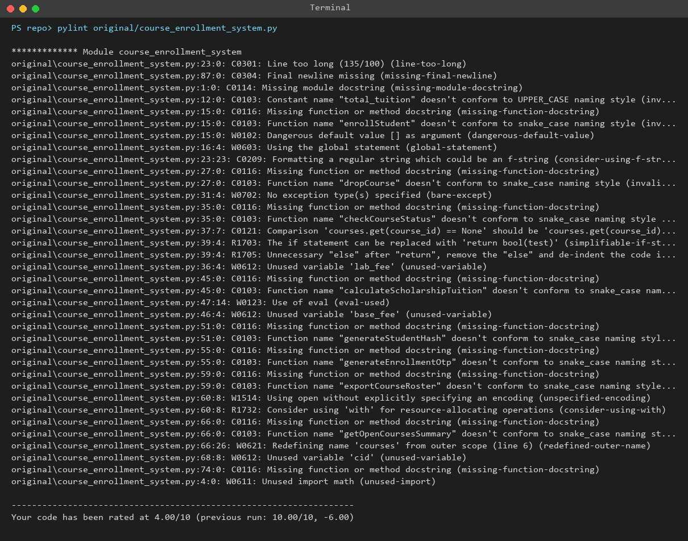
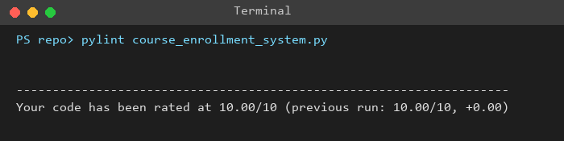
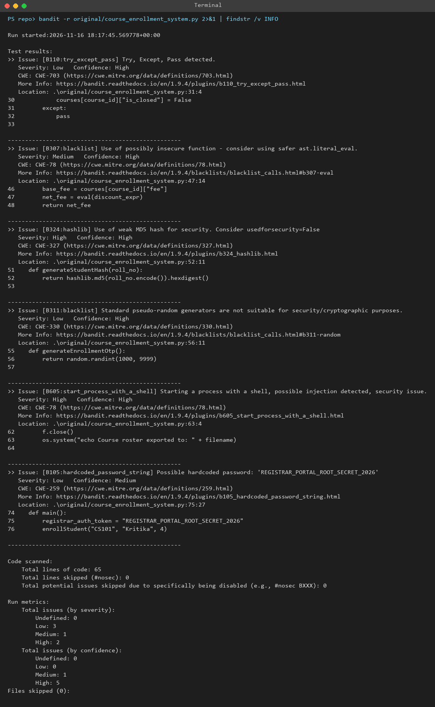
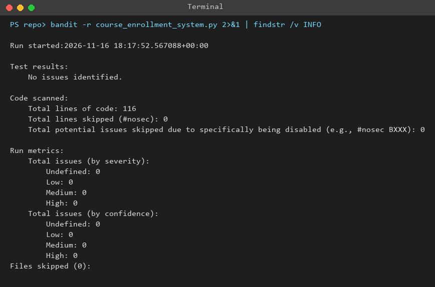
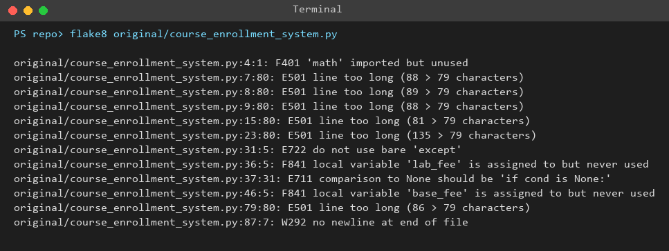
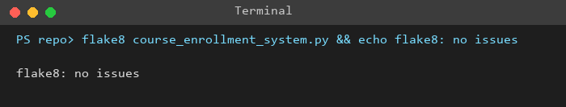
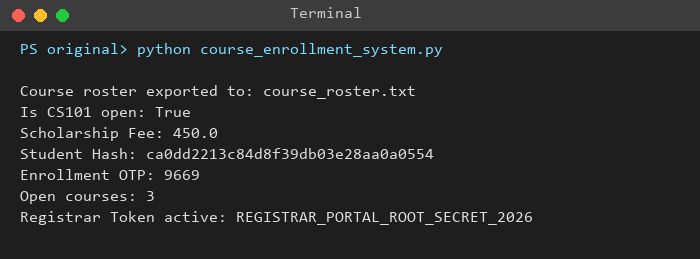
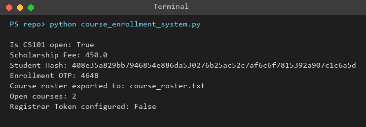

# Lab 5 — Static Code Analysis: Course Enrollment System

Static analysis of a university course enrollment program with **Pylint**, **Bandit** and **Flake8**, followed by fixing the findings.

| Tool | Before | After |
|------|--------|-------|
| Pylint | 4.00 / 10 | **10.00 / 10** |
| Bandit | 6 issues (2 High, 1 Medium, 3 Low) | **0** |
| Flake8 | 12 violations | **0** |

> Source material: `SETAPESU26/L5_52_course_enrollment_system` (copied and modified here; nothing is pushed back to it).

## Repository layout

```
.
├── course_enrollment_system.py   # cleaned & fixed program
├── original/                     # untouched original for comparison
├── reports/
│   ├── before/                   # pylint / bandit / flake8 reports on the original
│   └── after/                    # same reports on the fixed code
├── screenshots/                  # terminal screenshots of every run
├── issues.md                     # issue table (15 findings: tool, line, fix)
└── reflection.md                 # reflection answers
```

## Run it

```bash
python -m venv venv
venv\Scripts\activate          # Linux/macOS: source venv/bin/activate
pip install pylint bandit flake8
python course_enrollment_system.py
pylint course_enrollment_system.py
bandit -r course_enrollment_system.py
flake8 course_enrollment_system.py
```

## Commits (one per tool)

1. **Baseline** — original code, before-reports, screenshot
2. **Pylint fixes** — naming, docstrings, mutable default, bare except, `with open`, unused code, drop-course logic bug
3. **Bandit fixes** — no `eval`, SHA-256, `secrets`, no `os.system`, no hard-coded token
4. **Flake8 fixes** — line length, final newline, `__main__` guard

## Highlights

* **Security:** `eval()` replaced by a whitelisting `ast` evaluator; MD5 → SHA-256; shell call removed; secret moved to an environment variable and no longer printed.
* **Bug found by running, not by tools:** dropping a course nobody was enrolled in re-opened it (`Open courses: 3`). It is now refused (`Open courses: 2`) and tuition is refunded on real drops.
* Details: [issues.md](issues.md) · [reflection.md](reflection.md)

## Screenshots

| Before | After |
|--------|-------|
|  |  |
|  |  |
|  |  |
|  |  |
